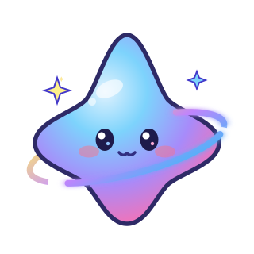
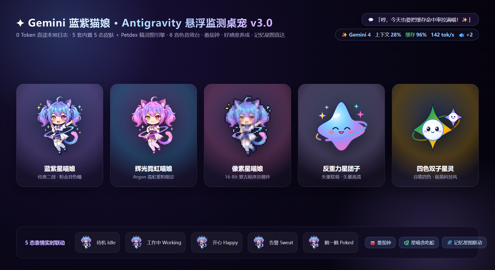

<p align="center">
  
</p>

<h1 align="center">Gemini 蓝紫猫娘 · Antigravity 悬浮监测桌宠</h1>

<p align="center">
  <b>随 Google Antigravity 自动联动的透明无边框悬浮监测桌宠工作站（5 套多风格皮肤 · 0 Token 实时账单监测 · 音效台 · 养成小游戏 · 记忆星图直达）</b>
</p>

<p align="center">
  
  
  
  
</p>

<p align="center">
  
</p>

---

## ✨ 为什么做这款桌宠？

一边用 **Google Antigravity** 写代码/做研究，一边总想知道：*“AI 现在是在跑命令还是在思考？当前上下文水位多高了？前缀缓存有没有断层？今天消耗了多少 Token？”*

**`agy-gemini-pet`** 是一款**零侵入、不改 Antigravity 本体、消耗 0 模型 Token** 的透明悬浮桌宠插件——它通过 Antigravity 官方 Sidecar 机制随客户端自动拉起与退出，直接从本地会话日志实时解析状态，用可爱的动画、气泡和工具箱陪你高效 Vibe Coding！

---

## 🧩 五大核心模块

### 1. 实时监测 & 细粒度工具态感知（`监测` / `账单`）
* **0 Token 本地直读**：毫秒级感知 Agent 正在执行的动作：`💻 跑命令中` / `✏️ 写代码中` / `🔍 查资料中` / `📖 读文件中` / `🤖 派子代理` / `✨ 思考中` / `💤 打盹中`。
* **工作态免打扰**：AI 跑工具链中途保持安静不弹闲聊，等整轮完成或检测到**缓存断层 / 上下文超水位**时才温柔提醒。
* **完整 Token 账单**：实时上下文水位（支持 Gemini 4 `512K` / 三代 `256K` / Claude `200K`）、Prefix Cache 命中率、输出速度（`tok/s`）、今日 / 近 7 天趋势图、模型分布与多会话切换。

### 2. 5 套内置皮肤 + Petdex / 精灵图引擎（`形象`）
* 内置 **5 套 5 态（待机 / 工作中 / 开心 / 冒汗告警 / 戳一戳）** 专属形象：
  * **蓝紫星喵娘**（经典二创 · 粉金异色瞳）
  * **辉光霓虹喵娘**（Argon 霓虹紫粉限定）
  * **像素星喵娘**（16-Bit 复古程序员情怀）
  * **反重力星团子**（失重软萌 · 矢量高清 SVG）
  * **四色双子星灵**（谷歌红黄蓝绿 · 极简科技风）
* 支持**一键导入自定义单图皮肤**（可逐态替换）以及导入社区 **Petdex（`pet.json` + 图集）与 Spritesheet 精灵图目录**，内置 Canvas 逐帧播放与 `1–24 FPS` 帧率调节。

### 3. 陪伴养成 & 解闷小游戏（`陪伴`）
* **星光小鱼干经济（`🐟`）**：每轮对话完成掉 `+1 🐟`（缓存命中率 ≥ 85% 掉 `+2 🐟`）、番茄钟完成掉 `+3 🐟`、贪吃蛇 ≥ 10 分掉 `+1 🐟`。
* **7 级羁绊养成**：支持摸头互动、喂食提升好感度（`初次邂逅` → `反重力星灵契约者`），支持给每套形象起专属昵称。
* **内置星喵贪吃蛇（`🐍`）**：等 AI 深度思考时随时开一局（支持 WASD / 方向键 / 鼠标点击，自动保存最高分）。

### 4. 专注效率工具箱 + 记忆星图联动（`工具`）
* **🍅 番茄专注钟**：墙钟持久化（重启不丢倒计时），专注中自动在猫娘脚下胶囊显示实时倒计时。
* **💧 久坐 & 喝水提醒**：内置防打扰冷却，AI 干活时自动延后不打断。
* **📝 悬浮小便签**：随时把当前要盯的任务要点挂在猫娘上方。
* **🌌 一键直达记忆星图**：右键菜单或面板一键弹出你的本地 3D 风格记忆星云——搭配姊妹插件 **[`agy-local-memory`（纯本地认知图谱记忆星图）](https://github.com/pvijaypal2000-tech/agy-local-memory)** 使用体验拉满！

### 5. 参数化音效工作台（`音效`）
* 内置 **6 套纯 Web Audio 物理合成音色包**（软萌猫铃 / 赛博辉光 / 8-Bit 电玩 / 清脆水滴 / 星光风铃 / Lo-Fi 电钢），无需外置音频文件。
* 支持 **5 项实时旋钮调参**（音量 / 音高变调 / 节奏倍速 / 余韵延音 / 明亮度滤波）+ 6 类事件独立混音 + 本地 `.mp3 / .wav / .ogg` 音频导入。

---

## 🚀 一键安装（Windows 10 / 11）

> 💡 目前窗口边缘磁吸吸附功能依赖 Windows PowerShell 窗口追踪脚本（`scripts/win-tracker.ps1`），推荐在 **Windows 10 / 11** 下使用；欢迎 macOS / Linux 开发者提 PR 适配窗口追踪！

### 前置条件
* 已安装 **Google Antigravity** 桌面端
* 已安装 **Node.js 18+**（[nodejs.org](https://nodejs.org/)）

### 安装步骤

1. 获取安装包（任选一种方式）：
   * **方式 A（推荐，免装 Git）**：前往右侧 **[Releases 页面](https://github.com/pvijaypal2000-tech/agy-gemini-pet/releases/latest)** 下载 `agy-gemini-pet-v3.0.0.zip` 并解压到一个**长期保留的文件夹**（例如 `D:\Apps\agy-gemini-pet`，安装后不要随意移动目录）。
   * **方式 B（Git 克隆）**：
     ```bash
     git clone https://github.com/pvijaypal2000-tech/agy-gemini-pet.git
     cd agy-gemini-pet
     ```
2. 双击运行 **`install.bat`**（或在终端运行 `npm install && npm run install:plugin`）：
   * 自动下载 Electron 运行环境；
   * 自动把插件元信息与动态生成的 `sidecar.json` 注册到 `~/.gemini/config/plugins/agy-gemini-pet/`。
3. **完全退出并重启一次 Antigravity 桌面端**，蓝紫猫娘就会自动出现在 Antigravity 窗口右下角，并随 Antigravity 关闭而优雅退出！

### 单独预览 / 手动启动
如果想不通过 Sidecar 单独预览桌宠，直接双击：
* `start-widget-silent.vbs`（无黑窗静默启动）
* 或 `start-widget.bat` / 终端执行 `npm start`

---

## 🔗 姊妹插件推荐

搭配同系列纯本地记忆插件一起使用，可在猫娘右键菜单或工具箱**一键打开记忆星图**：
* 🌌 **[agy-local-memory](https://github.com/pvijaypal2000-tech/agy-local-memory)** — 零依赖纯本地认知图谱记忆引擎 + Canvas 2D 银河星云可视化（支持 Antigravity MCP App 侧边栏直开）

---

## 📂 仓库结构

```text
agy-gemini-pet/
├── install.bat                  # Windows 一键安装入口
├── install_plugin.mjs           # 动态注册 Antigravity Sidecar 插件脚本
├── start-widget-silent.vbs      # 静默独立启动脚本
├── start-widget.bat             # 命令行启动脚本
├── package.json                 # Electron 依赖与脚本定义
├── LICENSE                      # MIT 开源协议与素材声明
├── plugin/
│   └── plugin.json              # Antigravity 插件元信息模板
├── assets/
│   ├── logo.svg                 # 插件图标
│   ├── preview-skins.png        # 5 套皮肤与 5 态表情预览图
│   ├── skins/                   # 5 套内置 5 态主题皮肤（PNG + SVG）
│   └── sprites/                 # 默认兜底立绘与系统托盘图标
├── scripts/
│   ├── win-tracker.ps1          # Windows Antigravity 窗口磁吸追踪脚本
│   ├── test-parser.js           # 本地会话日志解析自测脚本
│   └── ...                      # 皮肤变体与矢量生成工具脚本
└── src/
    ├── core/                    # 日志解析、配额估算、皮肤管理、状态持久化
    ├── main/                    # Electron 主进程、窗口追踪、托盘、记忆星图联动
    └── renderer/                # 悬浮桌宠视图、音效合成台、工具箱、星喵贪吃蛇
```

---

## 🙏 致谢与协议

本项目采用 **[MIT License](LICENSE)** 开源。

* 内置角色立绘（`catgirl-classic`、`catgirl-argon`、`pixel-retro`）为本项目专属 AI 生成与后处理制作，矢量萌物皮肤（`star-slime`、`google-fourcolor`）为程序化 SVG 绘制，遵循仓库开源协议。
* 桌面监测桌宠设计灵感来源于社区优秀桌面伴侣项目（`dsh-whale-widget`、`dsh-pet`、`dsh-whale-musume`）及 Petdex 精灵图规范。
